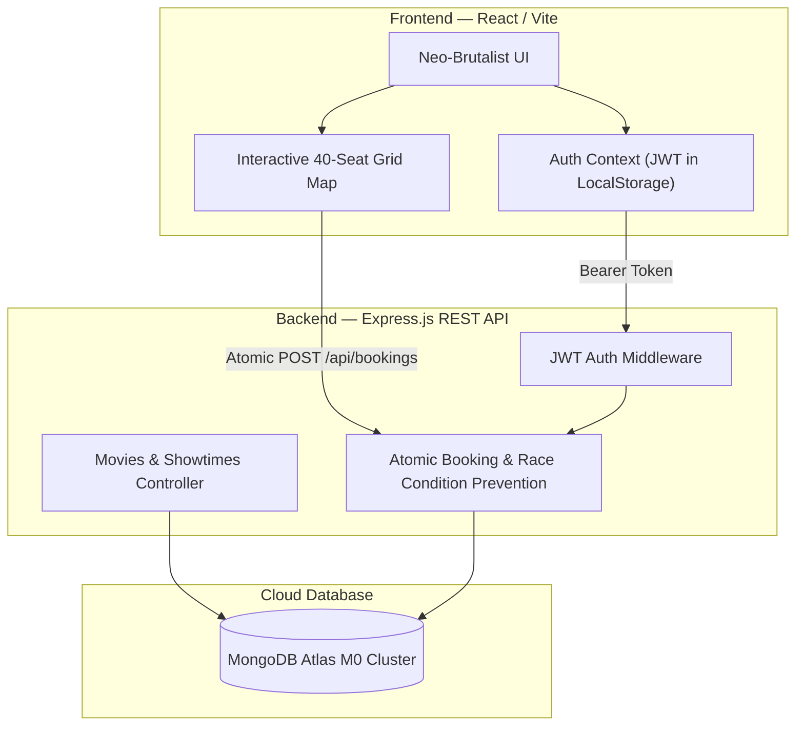
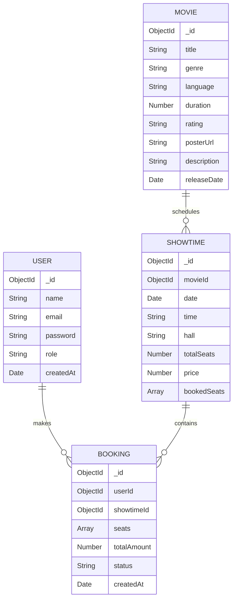

# 🎬 IMovies — Neo-Brutalist Movie Ticket Booking Platform

> **Project Type:** Individual Capstone Project  
> **Aesthetic:** Neo-Brutalism (Hacktoberfest 2026 inspired)  
> **Author:** Saransh  
> **Version:** 1.0.0  

---

## ⚡ Executive Summary

**IMovies** is a full-stack online movie ticket booking platform built for speed, transparency, and personality. Inspired by the **Hacktoberfest 2026** design language and the broader Neo-Brutalist movement, IMovies strips away corporate bloat, invasive tracking cookies, and 20-step checkout funnels in favor of an honest, tactile, and developer-culture-rooted experience: **browse, select seats on a live interactive auditorium map, and book.**

The backend is intentionally kept **lean and robust** (Express.js + MongoDB Mongoose), while the frontend delivers a **bold, high-contrast, unapologetically raw UI** using React (Vite) and a custom Neo-Brutalist design system.

---

## 🎨 Neo-Brutalist Design System

The visual design language is grounded in raw structure and high tactile feedback:
- **Hard Borders:** 3px to 5px solid `#000000` on all interactive cards, buttons, and inputs.
- **Zero-Blur Drop Shadows:** Physical `box-shadow: 5px 5px 0px #000000` with active depression on click (`translate(4px, 4px)`).
- **High-Contrast Palette:**
  - Background (Paper): `#F5F0E8`
  - Terminal Black: `#1A1A1A`
  - Acid Yellow (Primary CTA): `#FFEE00`
  - Electric Magenta (Highlights): `#FF0055`
  - Cyan Glow (Info / Tags): `#00FFFF`
  - Neon Green (Available Seats): `#00FF66`
  - Hot Red (Booked Seats / Danger): `#FF3333`
- **Typography:**
  - Headings: `Archivo Black`, `Impact`, sans-serif (ALL-CAPS headings)
  - Body: `Space Grotesk`, sans-serif
  - Monospace Accents: `Space Mono`, monospace

---

## 🏗️ Architecture & Component Flow



---

## 📊 Database Schema (ERD)



---

## 🔌 REST API Endpoints

### 1. Authentication
- `POST /api/auth/register` — Create user account (name, email, password). Returns JWT token.
- `POST /api/auth/login` — Authenticate user credentials. Returns JWT token.
- `GET /api/auth/me` — *(Protected)* Retrieve current user session.

### 2. Movies
- `GET /api/movies` — List all movies (supports `?genre=` and `?search=` query filters).
- `GET /api/movies/:id` — Get single movie details and all scheduled showtimes.

### 3. Showtimes
- `GET /api/showtimes/:id` — Get showtime details with live `bookedSeats` list.

### 4. Bookings *(Protected — Bearer JWT required)*
- `POST /api/bookings` — Book seats. Features **atomic double-booking prevention** via `{ _id, bookedSeats: { $nin: seats } }`. Returns `409 Conflict` if any seat was taken.
- `GET /api/bookings/me` — List all bookings for the logged-in user.
- `PATCH /api/bookings/:id/cancel` — Soft-cancel a booking and atomically release seats (`$pull`).

---

## 🚀 Quick Start (Local Development)

### Prerequisites
- Node.js (v18+ or v20+)
- MongoDB (Local instance or MongoDB Atlas URI)

### 1. Clone & Setup
```bash
git clone https://github.com/your-username/imovies.git
cd imovies
```

### 2. Install Dependencies
```bash
# Server dependencies
cd server
npm install

# Client dependencies
cd ../client
npm install
cd ..
```

### 3. Environment Configuration
Create `server/.env`:
```env
PORT=5000
NODE_ENV=development
MONGO_URI=mongodb://127.0.0.1:27017/imovies
JWT_SECRET=imovies_super_secret_jwt_key_2026
CLIENT_URL=http://localhost:5173
```

Create `client/.env`:
```env
VITE_API_URL=http://localhost:5000
```

### 4. Seed Database (Demo Data)
```bash
npm run seed
```
This populates 6 feature films, 12 showtimes, and two demo accounts:
- **User:** `demo@imovies.com` / `password123`
- **Admin:** `admin@imovies.com` / `admin123`

### 5. Start Servers
```bash
# Start backend on http://localhost:5000
npm run dev:server

# In a second terminal, start frontend on http://localhost:5173
npm run dev:client
```

---

## 🧪 Automated Testing

Run the automated backend test suite:
```bash
npm test
```
The test suite validates:
1. **Password Hashing:** Salt generation, hashing, and `bcrypt.compare` verification.
2. **JWT Security:** Signing, expiration, tampering rejection, and secret validation.
3. **Auth Middleware:** Header missing, malformed token, and successful injection of `req.user`.
4. **Concurrency & Double-Booking Prevention:** Simulates simultaneous booking attempts on identical seats, ensuring HTTP 409 Conflict rejection.
5. **Seat Release on Cancellation:** Simulates `$pull` operations on seat release.
6. **Seed Data Integrity:** Validates all required fields, durations, and movie catalogs.
7. **Express Route Mounts:** Confirms all 11 REST endpoints are active and bound.

---

## 🌐 Deployment Options

IMovies supports all deployment models requested:

### Option 1: Two Different Platforms (Frontend on Vercel, Backend on Render) — *Recommended*
1. **Database:**
   - Create a free M0 cluster on [MongoDB Atlas](https://cloud.mongodb.com).
   - In Network Access, whitelist `0.0.0.0/0`.
   - Copy connection string into `MONGO_URI`.
2. **Backend (Render):**
   - In [Render Dashboard](https://dashboard.render.com), create a new **Web Service**.
   - Root directory: `server`.
   - Build command: `npm install`.
   - Start command: `node server.js`.
   - Set environment variables: `MONGO_URI`, `JWT_SECRET`, `NODE_ENV=production`.
   - Note your backend URL: e.g. `https://imovies-api.onrender.com`.
3. **Frontend (Vercel):**
   - In [Vercel Dashboard](https://vercel.com), import the repository.
   - Root directory: `client`.
   - Framework preset: `Vite`.
   - Environment variable: `VITE_API_URL=https://imovies-api.onrender.com`.
   - Deploy.

---

### Option 2: Both on Render (Blueprint Deployment)
The repository includes a ready-to-deploy `render.yaml` blueprint:
1. Connect repository in Render.
2. Choose **Blueprints** -> Select `render.yaml`.
3. Render will provision:
   - `imovies-api`: Web Service for Express.js.
   - `imovies-client`: Static Site for Vite React with automatic route rewrites to `/index.html`.
4. Supply your `MONGO_URI` in the dashboard.

---

### Option 3: Both on Vercel (Monorepo Serverless)
The repository includes root `vercel.json` and `api/index.js`:
1. In Vercel, import repository with root directory `/`.
2. Vercel automatically detects the static build for `/client` and serverless functions under `/api`.
3. Set environment variables `MONGO_URI` and `JWT_SECRET` in the Vercel project settings.

---

## 🏆 Evaluation Checklist (Capstone Ready)

- [x] **Clean, modular codebase** with distinct `client/` and `server/` boundaries.
- [x] **RESTful API** with proper HTTP status codes (`200`, `201`, `400`, `401`, `404`, `409`, `500`).
- [x] **JWT Authentication & bcrypt** password encryption with route protection.
- [x] **Anti-Race-Condition Booking:** Atomic seat updates preventing double-booking.
- [x] **Responsive Neo-Brutalist UI:** Custom CSS design system inspired by Hacktoberfest 2026.
- [x] **Interactive Seat Map:** 40 seats with visual cinema screen, aisle gap, and live selection.
- [x] **My Bookings Dashboard:** View passes and cancel reservations with instant seat release.
- [x] **Turn-Key Deployment Files:** `render.yaml`, `vercel.json`, and `.env.example` included.
- [x] **Demo Data Seed Script:** 6 movies, 12 showtimes, and evaluator demo accounts.
- [x] **Automated Test Suite:** 100% test pass rate across 6 test suites.

---

## 📜 License
MIT License. Created by Saransh for individual Capstone submission.
